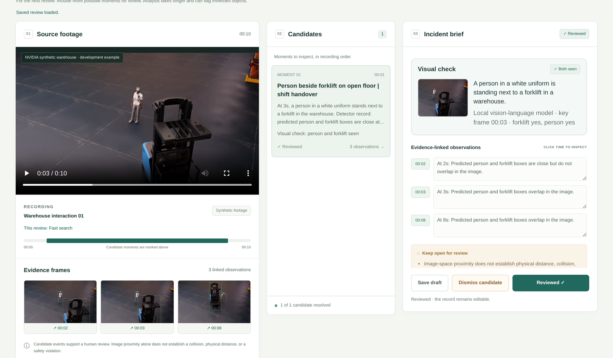
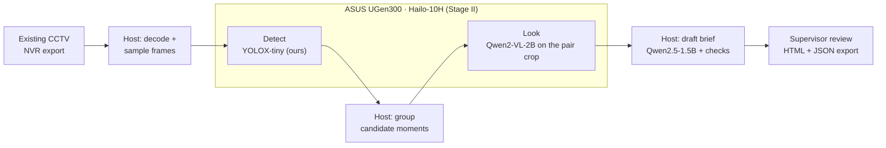

# TraceBrief

**Find the forklift close call in your CCTV, check what the camera saw, and hand over an evidence-linked report, on the site's own PC.**

When a near miss with a forklift is reported, someone has to find the right seconds in hours of footage, check what is visible and write it up. TraceBrief does that work locally:

1. **Detect.** A YOLOX-tiny detector we trained for people and forklifts scans the recording and groups moments where their boxes come close.
2. **Look.** A vision-language model (Qwen2-VL-2B) checks a crop around each candidate: is there really a person and a forklift, and what are they doing? Candidates it doubts are flagged for the reviewer, never removed.
3. **Brief.** A local language model drafts the incident brief. The detector's timeline is restated verbatim, every observation links to its frame, and rule checks fall back to a labeled template.
4. **Review.** The supervisor edits, dismisses with a reason or marks the record reviewed, then exports a standalone HTML report and a JSON record with the source-video hash and the edit history.

Built for the ASUS UGen AI League, Battlefield Lightning. Stage I runs every model on a host CPU; Stage II moves detection and the visual check onto one ASUS UGen300 (Hailo-10H). No cloud API is called.





## Results on held-out synthetic footage

All numbers come from NVIDIA's synthetic warehouse dataset with simulator annotations, on simulation runs never used for training or tuning. Raw predictions, frozen settings and scoring scripts are in `data/evaluation/`.

| Detector profile | Pair precision | Pair recall | Median vision time per 10 s clip (CPU) |
|---|---|---|---|
| **Fast**: YOLOX-tiny trained by us | **98.1%** (51/52) | 86.4% (51/59) | **0.79 s** |
| **Broader**: Grounding DINO tiny, default for new camera views | 90.2% (55/61) | **93.2%** (55/59) | 71.3 s |
| Stricter: Grounding DINO tiny, higher threshold | 90.2% (37/41) | 62.7% (37/59) | 36.6 s |

A pair counts only when both the person box and the forklift box match the annotation at IoU ≥ 0.5 (9 scorable test runs, 90 sampled frames; timing over all 10 inputs on an Intel Core i7-10700, including model loading). Details: [VISION_RESULTS.md](docs/VISION_RESULTS.md), [COMPACT_DETECTOR.md](docs/COMPACT_DETECTOR.md).

**Visual check (Qwen2-VL-2B, CPU).** On 148 crops from the same held-out cohort, labeled by eye before the model ran and with the prompt frozen on development crops, it confirmed **104 of 106** gold-matched person–forklift pairs and agreed with the labels on 144 of 148 crops, at a median **8.3 s per crop** on 12 CPU threads. It does not yet reject shelving reliably: in development the chosen prompt caught 6 of 22 shelf crops, and a stricter prompt that caught all 22 also rejected 6 of 17 real forklifts, so we kept the balanced one. 5 of 20 sampled descriptions contained a clear factual error, which is why the app shows them as model notes. Protocol, labels and every answer: [data/evaluation/look](data/evaluation/look/README.md).

## UGen300 plan

The detector compiles to a Hailo-10H HEF (Hailo lists `yolox_tiny` for Hailo-10H at about 400 FPS) and Qwen2-VL-2B runs from Hailo's GenAI Model Zoo (1.02 s to first token, 7.04 tokens/s). Hailo documents one vision app and one GenAI app sharing a device, which is exactly this split; the host keeps decoding, drafting, review and export. The compile script (`scripts/hailo/compile_yolox_hef.py`) and device backends (`src/tracebrief/hailo_backend.py`) are written against HailoRT 5.4 and will be verified on the device in Stage II. Measurements and pass criteria: [HARDWARE_PLAN.md](docs/HARDWARE_PLAN.md).

## Install

Linux or WSL with Python 3.11+, several free CPU cores, about 8 GB of free RAM and about 9 GB of free disk for three environments and the models. Native Windows setup is not verified. From this directory:

```bash
# Ubuntu / Debian / WSL prerequisites, once.
sudo apt-get update
sudo apt-get install -y python3-venv python3-dev build-essential cmake ffmpeg

# 1. HTTP server environment (standard library only).
python3 -m venv .venv-app

# 2. Vision environment: CPU PyTorch for Grounding DINO, ONNX Runtime for our detector.
python3 -m venv .venv-vision
.venv-vision/bin/python -m pip install --upgrade pip
.venv-vision/bin/python -m pip install torch==2.14.1 torchvision==0.29.1 --index-url https://download.pytorch.org/whl/cpu
.venv-vision/bin/python -m pip install -r scripts/vision_requirements.txt

# 3. Local language and vision-language models (llama.cpp; compiles if no wheel is available, several minutes).
python3 -m venv .venv-llm
.venv-llm/bin/python -m pip install --upgrade pip
CMAKE_BUILD_PARALLEL_LEVEL=4 CMAKE_ARGS="-DGGML_CUDA=OFF" .venv-llm/bin/python -m pip install -r scripts/generation_requirements.txt

# 4. Pinned model downloads with hash checks (about 3.4 GB). Nothing is downloaded at inference time.
.venv-vision/bin/python scripts/vision_download.py --output models/grounding-dino-tiny
.venv-app/bin/python scripts/generation_download.py --output models/qwen
.venv-app/bin/python scripts/look_download.py --output models/qwen2-vl
```

Our trained detector (`weights/yolox-tiny-warehouse.onnx`, about 20 MB) is included. The other models are pinned to exact revisions: [Grounding DINO tiny](https://huggingface.co/IDEA-Research/grounding-dino-tiny/tree/a2bb814dd30d776dcf7e30523b00659f4f141c71), [Qwen2.5-1.5B-Instruct GGUF Q4_K_M](https://huggingface.co/Qwen/Qwen2.5-1.5B-Instruct-GGUF/tree/91cad51170dc346986eccefdc2dd33a9da36ead9) and [Qwen2-VL-2B-Instruct GGUF Q4_K_M + projector](https://huggingface.co/ggml-org/Qwen2-VL-2B-Instruct-GGUF/tree/bb307c036e8a1ed7b663bbd0c35b41c4c9294cfd). No API key or cloud endpoint is needed. If `llama-cpp-python` fails to build, see its [installation guide](https://github.com/abetlen/llama-cpp-python#installation).

## Run

```bash
export TRACEBRIEF_VISION_PYTHON="$PWD/.venv-vision/bin/python"
export TRACEBRIEF_MODEL_DIR="$PWD/models/grounding-dino-tiny"
export TRACEBRIEF_LLM_PYTHON="$PWD/.venv-llm/bin/python"
export TRACEBRIEF_LLM_MODEL="$PWD/models/qwen/qwen2.5-1.5b-instruct-q4_k_m.gguf"
export TRACEBRIEF_VLM_MODEL="$PWD/models/qwen2-vl/Qwen2-VL-2B-Instruct-Q4_K_M.gguf"
export TRACEBRIEF_VLM_PROJECTOR="$PWD/models/qwen2-vl/mmproj-Qwen2-VL-2B-Instruct-Q8_0.gguf"
export HF_HUB_OFFLINE=1 TRANSFORMERS_OFFLINE=1

.venv-app/bin/python scripts/check_setup.py          # files, tools and imports; no inference
PYTHONPATH=src .venv-app/bin/python -m tracebrief --host 127.0.0.1 --port 8765
```

Open **http://127.0.0.1:8765**, choose **Warehouse interaction 01**, pick **Fast search** and click **Review recording**. On our CPU, Fast search with the visual check and the draft took 30 s for the 10-second clip (detection 0.8 s, visual check 13 s, draft about 15 s); Broader search adds about a minute of detection. Click any observation time to jump to that frame, edit the brief, then **Export review**.

A saved review reopens at `http://127.0.0.1:8765/?review=<job-id>` without rerunning analysis. The server has no login and is meant to stay bound to loopback. Without the two `TRACEBRIEF_VLM_*` variables the app still runs and labels the visual check as unavailable; without the language model it uses the labeled template.

## Search profiles

- **Fast search**: our YOLOX-tiny. Highest precision and about a second per clip on CPU. Its forklift training views were overhead, so it can miss parked forklifts seen from ground level.
- **Broader search (default)**: Grounding DINO tiny at a low threshold. Highest recall and the safe default for camera views we have not calibrated, because a missed interaction costs more than an extra review.
- **Stricter search**: Grounding DINO with a higher threshold and smaller images. Fewer candidates, more misses.

The selector applies to the next analysis; each record keeps the profile and the exact settings it was run with.

## Settings and records

| Variable | Purpose |
|---|---|
| `TRACEBRIEF_VISION_PYTHON` | Interpreter with the vision dependencies |
| `TRACEBRIEF_MODEL_DIR` | Grounding DINO directory |
| `TRACEBRIEF_LLM_PYTHON` / `TRACEBRIEF_LLM_MODEL` | llama.cpp interpreter and the Qwen2.5 GGUF used for drafting |
| `TRACEBRIEF_VLM_MODEL` / `TRACEBRIEF_VLM_PROJECTOR` | Qwen2-VL-2B GGUF and projector for the visual check |
| `TRACEBRIEF_VLM_THREADS` | CPU threads for the visual check (default: up to 8) |
| `TRACEBRIEF_RUNTIME` | Job and upload directory (default `.runtime/`) |

Each job stores its source hash, detector settings and raw output, linked frames, visual-check crop and answer, the raw draft and check results, reviewer edits and status. Do not run two servers on the same runtime directory.

## Tests and troubleshooting

```bash
.venv-vision/bin/python -m pip install pytest==9.1.1
PYTHONPATH=src .venv-vision/bin/python -m pytest tests -q
```

The tests cover review integrity, API inputs, the ONNX detector, the visual check, draft composition and the Hailo output mapping; they do not run the language models.

- **Analysis fails:** read `.runtime/jobs/<job-id>/vision.log` and rerun `check_setup.py`.
- **Visual check unavailable:** read `.runtime/jobs/<job-id>/look-<event>.log`; check both `TRACEBRIEF_VLM_*` paths with `scripts/look_download.py --verify --output models/qwen2-vl`.
- **Template draft shown:** the draft warning and `generation-*-audit.json` say which check failed.
- **Video does not play:** use an H.264 MP4; evidence frames remain reviewable either way.
- **Interrupted job:** restarting marks unfinished jobs failed; start a new review.

## Repository map

| Path | Contents |
|---|---|
| `src/tracebrief/` | Server, detector wrappers (`vision.py`, `compact_vision.py`), visual check (`look.py`), drafting checks (`generation.py`), Hailo backends (`hailo_backend.py`) |
| `scripts/` | Model workers, downloaders, evaluation and scoring scripts; `compact/` detector training; `hailo/` HEF compilation |
| `web/` | Review workspace (plain HTML, CSS and JavaScript) |
| `config/` | The three frozen search profiles |
| `data/samples/` | Three bundled synthetic clips with provenance |
| `data/evaluation/` | Frozen settings, raw predictions, labels and results behind every reported number |
| `docs/` | [FAQ](docs/FAQ.md), [hardware plan](docs/HARDWARE_PLAN.md), [vision protocol](docs/VISION.md) and [results](docs/VISION_RESULTS.md), [drafting results](docs/GENERATION_RESULTS.md), [sources](docs/SOURCES.md), [third-party notices](docs/THIRD_PARTY_NOTICES.md) |

## Limits

- All footage is synthetic; a one-camera site pilot comes after device integration.
- A candidate means two predicted boxes were close in the image. It does not establish distance, contact, fault or a safety violation; the reviewer decides from the footage.
- The visual check and the draft can be wrong. Both are labeled as model output, and every claim links back to a frame.

## License

TraceBrief code is Apache-2.0 ([LICENSE](LICENSE), [NOTICE](NOTICE)). Third-party models, footage and dependencies keep their own licenses: the bundled NVIDIA synthetic clips are OpenMDW-1.1 ([manifest](data/samples/manifest.json)). See [third-party notices](docs/THIRD_PARTY_NOTICES.md) and `docs/licenses/`.
