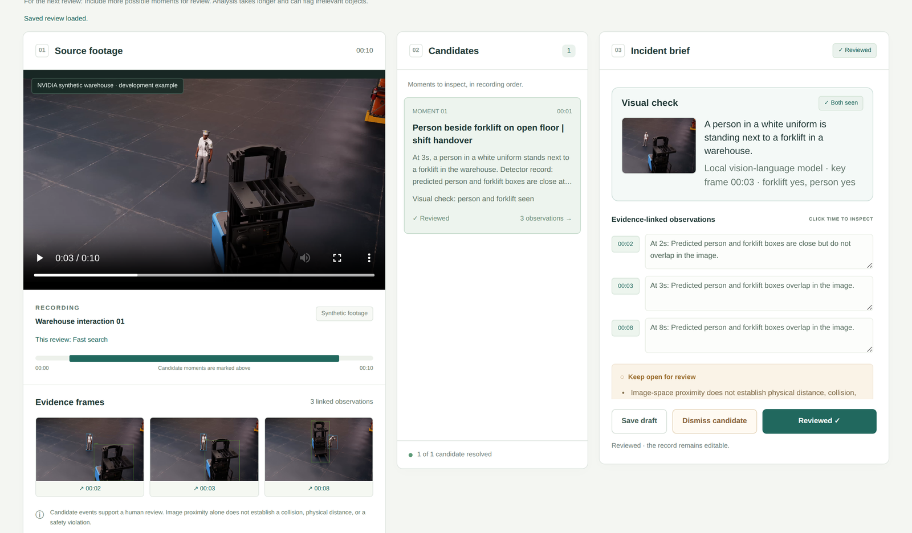
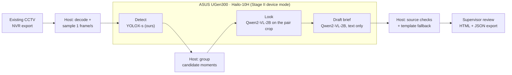

# TraceBrief

**Find the forklift close call in your CCTV, check what the camera saw, and hand over an evidence-linked report, on the site's own PC.**

When a near miss with a forklift is reported, someone has to find the right seconds in hours of footage, check what is visible and write it up. TraceBrief does that work locally:

1. **Detect.** A YOLOX-s detector we trained for people and forklifts on synthetic and real warehouse images (detector v4) runs over the recording and groups moments where their boxes come close.
2. **Look.** A vision-language model (Qwen2-VL-2B) checks a crop around each candidate: is there really a person and a forklift, and what are they doing? Candidates it doubts are flagged for the reviewer, never removed.
3. **Brief.** A local language model drafts the title, a scene sentence and review questions. The box timeline is not left to the model: one sentence restates the detector record, listing the times the boxes are close and the times they overlap. Every observation links to its frame, and a draft that fails the rule checks is replaced by a labeled template.
4. **Review.** The supervisor edits, dismisses with a reason or marks the record reviewed, then exports a standalone HTML report and a JSON record with the source-video hash and the edit history.

Built for the ASUS UGen AI League, Battlefield Lightning. Stage I runs every model on the host CPU and drafts with Qwen2.5-1.5B. In Stage II's device mode the detector, the visual check and the draft run on one ASUS UGen300 (Hailo-10H): one vision model (the detector) and one GenAI model (Qwen2-VL-2B, which also drafts the brief in text-only mode). No cloud API is called.

**Quick start:** [install](#install) and [run](#run) on the host CPU (Linux or WSL, Python 3.12 or newer), or [run on a UGen300](#run-on-ugen300) (Windows 11, Python 3.10, HailoRT 5.3.2).





In Stage I every step runs on the host CPU, and the draft comes from Qwen2.5-1.5B.

## Stage II status

- **Detector v4 runs Fast search.** A YOLOX-s trained on synthetic and real images passed all <!-- fact: v4.criteria -->7 of 7 criteria we registered before training it. It is the first of our detectors to find real forklifts, but at an unseen real site it found only about a third of them. The YOLOX-tiny arm trained alongside failed the real-site recall criterion and was not adopted. The Stage I detector stays selectable so its results can be reproduced. [Results below](#detector-v4-results-stage-ii).
- **Device mode runs on the UGen300, so far at reduced power.** With `TRACEBRIEF_BACKEND=hailo` the detector, the visual check and the draft run on one UGen300 (`src/tracebrief/hailo_backend.py`, `device_pipeline.py`). We compiled detector v4 to a Hailo-10H HEF and ran it on the device over USB: <!-- fact: device.detector_fps_b8 -->202–205 FPS at batch 8, with pair precision / recall <!-- fact: device.pair_precision -->96.3% / <!-- fact: device.pair_recall -->88.1% against the ONNX model's <!-- fact: v4.pair_precision -->96.4% (53/55) / <!-- fact: v4.pair_recall -->89.8% (53/59). Qwen2-VL-2B answers a visual check in 13–17 s (<!-- fact: device.vlm_speed -->2.54–2.56 s to first token, 4.0–4.1 tokens/s). The port supplied only 0.9 A, so HailoRT ran the module in reduced-performance mode; these figures must be re-measured on a 3 A USB-C port. [UGen300 below](#ugen300-device-mode).
- **The detector and the VLM take turns on the device.** While the VLM generates in the same process the detector gets <!-- fact: device.same_process_fps -->0.37–0.43 FPS (the HailoRT binding holds Python's GIL), and on a Windows host a second process cannot open the USB device at all. So a device job runs in phases: the whole clip is detected first, then every candidate is checked, then every draft is written. A second process is refused at once, with the reason.
- **Resident CPU workers.** On the CPU path the visual check and the draft keep their model loaded between candidates instead of starting a process per candidate; on our samples the answers and drafts are the same as before.
- **Evidence frames are frame-exact.** Every evidence frame and visual-check crop now shows the frame the detector analysed. Before, an ffmpeg seek could show a later frame: on the SDG clips up to 29 frames later, wherever the detector's frame was not a keyframe. No published number changes, because every Stage I test frame was a keyframe; details in [ERRATA.md](docs/ERRATA.md).
- **Windows and Ubuntu.** `scripts/run_tracebrief.py` (with `scripts/run-tracebrief.ps1` on Windows) finds the environments and models and starts the server; a GitHub Actions workflow runs the tests on Ubuntu and Windows with Python 3.10 and 3.12, and installs each pinned requirements file exactly as below.
- **Still pending:** on the device, every speed again on a 3 A USB-C port, an audit of the device drafts, host load with several cameras, the device's power draw and the 12-hour soak ([HARDWARE_PLAN.md](docs/HARDWARE_PLAN.md)); off the device, an independent re-label of the visual-check test crops.

## Stage I results on held-out synthetic footage

All numbers in this section come from NVIDIA's synthetic warehouse dataset with simulator annotations, on simulation runs never used for training or tuning, and describe the Stage I models; Fast here is the Stage I YOLOX-tiny, now the **Fast search (Stage I detector)** profile. Raw predictions, frozen settings and scoring scripts are in `data/evaluation/`.

| Detector profile | Pair precision | Pair recall | Median vision time per 10 s clip (CPU) |
|---|---|---|---|
| **Fast, Stage I model**: YOLOX-tiny trained by us | <!-- fact: fast.pair_precision -->**98.1%** (51/52) | <!-- fact: fast.pair_recall -->86.4% (51/59) | <!-- fact: fast.wall_s -->**0.79 s** |
| **Broader**: Grounding DINO tiny, default for new camera views | <!-- fact: broader.pair_precision -->90.2% (55/61) | <!-- fact: broader.pair_recall -->**93.2%** (55/59) | <!-- fact: broader.wall_s -->71.3 s |
| Stricter: Grounding DINO tiny, higher threshold | <!-- fact: stricter.pair_precision -->90.2% (37/41) | <!-- fact: stricter.pair_recall -->62.7% (37/59) | <!-- fact: stricter.wall_s -->36.6 s |

A pair counts only when both the person box and the forklift box match the annotation at IoU ≥ 0.5 (<!-- fact: test.scorable -->9 scorable test runs, 90 sampled frames). Nine runs from one simulator are a small, correlated sample: a difference of a pair or two between profiles is within its noise. Every profile samples <!-- fact: config.sample_fps -->1 frame per second, the frozen `sample_fps` in `config/vision*.json`; the 5 fps figures in the detector and hardware notes are a sensitivity run and a sizing scenario, not a shipped setting. Times are medians over all 10 test inputs on an Intel Core i7-10700, end to end including model loading. For the Stage I Fast model that is <!-- fact: fast.load_s -->0.1 s to load the model, <!-- fact: fast.inference_s -->0.2 s of inference (<!-- fact: fast.inference_ms -->20 ms per frame, about <!-- fact: fast.inference_fps -->49 frames/s on <!-- fact: config.threads -->4 threads) and <!-- fact: fast.other_s -->0.5 s outside the model, mostly decoding every frame of the 30 fps clip. Details: [VISION_RESULTS.md](docs/VISION_RESULTS.md), [COMPACT_DETECTOR.md](docs/COMPACT_DETECTOR.md); every number with its source file: [FACTS.md](docs/FACTS.md).

## Detector v4 results (Stage II)

Detector v4 was trained on the SDG synthetic runs plus NVIDIA SmartSpaces (synthetic) and two real-image sets, LOCO and keremberke (Roboflow forklift-dsitv), and frozen before any test. Data, criteria and decision rule were registered beforehand; each model was scored once per test set. Each model runs at its frozen confidence (Stage I 0.40, v4-S 0.25).

| Test | Stage I model (YOLOX-tiny) | **Detector v4 (YOLOX-s), Fast search** |
|---|---|---|
| Synthetic Stage I test frames: pair precision / recall | <!-- fact: fast.pair_precision -->98.1% / <!-- fact: fast.pair_recall -->86.4% | <!-- fact: v4.pair_precision -->96.4% / <!-- fact: v4.pair_recall -->89.8% |
| Synthetic held-out events found (strict) | <!-- fact: v4.old_events_strict -->26 of 33 | <!-- fact: v4.events_strict -->27 of 33 |
| Real images, unseen LOCO site: forklift AP50; precision / recall | <!-- fact: v4.old_loco -->0.0001; 0.00 / 0.00 | <!-- fact: v4.loco_ap50 -->**0.337**; <!-- fact: v4.loco_pr -->0.67 / 0.34 (bootstrap CI: <!-- fact: v4.loco_ci -->AP50 0.26–0.42, recall 0.27–0.41) |
| Real images, keremberke test (42 images): forklift / person AP50; pair recall | <!-- fact: v4.old_kb -->0.000 / 0.087; 0.00 | <!-- fact: v4.kb_ap50 -->**0.894 / 0.511**; <!-- fact: v4.kb_pair_recall -->0.68 (bootstrap CI: <!-- fact: v4.kb_ci -->forklift 0.80–0.97, person 0.34–0.70; pair recall 0.48–0.87) |
| NVIDIA SmartSpaces, re-used test (3rd use): forklift found per camera; person precision / recall | <!-- fact: v4.old_ss_found -->0.122; <!-- fact: v4.old_ss_person -->0.675 / 0.254 | <!-- fact: v4.ss_found -->0.332; <!-- fact: v4.ss_person -->0.821 / 0.565 |
| CPU inference, ms per frame (4 threads, two passes) | <!-- fact: v4.old_cpu_ms -->22.4 / 25.9 | <!-- fact: v4.cpu_ms -->40.5 / 37.3 |

Intervals are 95%: bootstrap over images for the real-image tests (images of one site are correlated, so these are optimistic) and Wilson for events. The held-out events differ by one, 27 against 26 of 33 (<!-- fact: v4.events_ci -->66–91% against 62–89%); that is not a measured improvement, only no loss.

Weaknesses: v4 finds only about a third of the forklifts at the unseen real site and half of the persons on keremberke; the keremberke test has only 42 images, 25 of them with a pair; LOCO's test site had been scored once before and the SmartSpaces scenes are a third use, so neither is fresh. On SmartSpaces it boxes humanoid robots as persons about ten times as often as the unshipped v3 study model (<!-- fact: v4.ss_humanoid_fp -->4997 against <!-- fact: v4.v3_ss_humanoid_fp -->507, the Stage I model <!-- fact: v4.old_ss_humanoid_fp -->18047). It costs about 1.6 times the Stage I model's CPU time per frame; a 10-second clip still takes about <!-- fact: v4.app_wall_s -->1.1 s end to end (41 ms per frame of inference). The YOLOX-tiny arm, v4-T, failed the real-site criterion, a forklift recall of at least 0.20 (it reached AP50 / recall <!-- fact: v4.tiny_loco -->0.271 / 0.154). Criteria, every deviation from the protocol and how to rerun Stage I: [COMPACT_DETECTOR.md](docs/COMPACT_DETECTOR.md#detector-v4); records: [data/evaluation/stage2/detector-v4](data/evaluation/stage2/detector-v4/README.md).

**Visual check (Qwen2-VL-2B, CPU).** We froze the prompt on development crops. The <!-- fact: look.crops -->148 test crops from the same held-out cohort were then labeled in a single pass from contact sheets that showed only the crop and the box outlines; the labels were recorded two minutes after the freeze and before the model ran, with no independent second labeler. The check confirmed <!-- fact: look.tp_confirmed -->**104 of 106** crops of person–forklift pairs that match the simulator annotations, at a median <!-- fact: look.median_s -->**8.3 s per crop** on 12 CPU threads. It agreed with the visual labels on both fields for <!-- fact: look.agreement_both -->144 of 148 crops, one fewer than answering yes to both questions for every crop would (<!-- fact: look.always_yes_both -->145 of 148), because only three test crops show no forklift. So the test shows that the check keeps true pairs; it does not show that it rejects false ones, and it does not yet reject shelving reliably: in development the chosen prompt caught <!-- fact: look.dev_shelf_flagged -->6 of 22 shelf crops, and a stricter prompt that caught all 22 failed to confirm <!-- fact: look.dev_v3_unconfirmed -->6 of 17 real forklifts, so we kept the balanced one. <!-- fact: look.desc_errors -->5 of 20 sampled descriptions contained a clear factual error, which is why the app shows them as model notes. An independent re-label of the test crops, and a test set with many more false candidates such as racks, are part of Stage II. Protocol, labels and every answer: [data/evaluation/look](data/evaluation/look/README.md). After the frame-timing fix of 2026-11-06 we cut every test crop again from the detector's frame: all <!-- fact: frame.stage1_identical -->148 of 148 are byte-identical to the ones the check saw, so these results stand ([ERRATA.md](docs/ERRATA.md)).

## UGen300 device mode

`TRACEBRIEF_BACKEND=hailo` runs every model of a job on the UGen300 from one process: it opens one VDevice with the ROUND_ROBIN scheduler and loads the detector HEF and Qwen2-VL-2B (from Hailo's GenAI Model Zoo; it also drafts the brief from text) on it once. The host keeps decoding, the source checks, review and export. It refuses a HEF whose SHA-256 is not recorded in the manifest or differs from it, and fails the job rather than fall back to the CPU. We target HailoRT <!-- fact: hailo.hailort -->5.3.x, the release ASUS ships for the UGen300, and Dataflow Compiler 5.3.0 for `scripts/hailo/compile_yolox_hef.py`.

Measured on one UGen300 over USB, HailoRT 5.3.2, Windows 11 host, **with a USB-C source advertising 0.9 A (reduced-performance mode); re-measure on a 3 A port before quoting these as the device's speed**:

| | UGen300 at 0.9 A |
|---|---|
| Detector v4 HEF (TraceBrief's Python path, host NMS included) | <!-- fact: device.detector_fps_b1 -->72–74 FPS at batch 1, <!-- fact: device.detector_fps_b8 -->202–205 FPS at batch 8 |
| HEF against ONNX, 9 Stage I runs: pair precision / recall | <!-- fact: device.pair_precision -->96.3% (52/54) / <!-- fact: device.pair_recall -->88.1% (52/59), against <!-- fact: v4.pair_precision -->96.4% / <!-- fact: v4.pair_recall -->89.8% |
| Qwen2-VL-2B: load; one visual check | <!-- fact: device.vlm_load_s -->10.5–14.0 s; <!-- fact: device.vlm_speed -->2.54–2.56 s to first token, 4.0–4.1 tokens/s (Hailo publishes 1.02 s and 7.04) |
| One clip, one candidate (`warehouse-1`) | <!-- fact: device.clip_phases -->5.2 s detection, 14.9 s visual check, 37.2 s draft; 57.4 s in all |
| Visual check of the 148 Stage I test crops, against the published CPU answers | <!-- fact: device.look_same_verdict -->144 of 148 with the same verdict; <!-- fact: device.look_tp_confirmed -->103 of 106 annotation-matched pairs confirmed (CPU 104); <!-- fact: device.look_seconds -->14.4 s per crop (median) |
| Drafts of the same 20 candidates on the device and on the CPU | <!-- fact: device.draft_accepted -->17 of 20 against 20 of 20 passed the source checks; 41.9 s per device draft (median) |
| The same 20 drafted by Hailo's Qwen2.5-1.5B HEF instead (rule fixed beforehand; rejected) | <!-- fact: device.llm_draft_accepted -->0 of 20 passed the source checks; <!-- fact: device.llm_draft_seconds -->52.7 s per draft (median); <!-- fact: device.llm_swap -->8.1 s to swap to it, but the VLM failed to load again after it in 7 of 7 recorded swaps back, and in the first, unrecorded run |

**Why jobs run in phases.** The detector and the VLM cannot work at the same time here: in one process the VLM's token read holds the GIL, which left the detector <!-- fact: device.same_process_fps -->0.37–0.43 FPS, and over USB on Windows a second process cannot open the device (`LIBUSB_ERROR_ACCESS`). So a single clip is detected whole, in batches of 8, then every candidate gets its visual check, then every draft is written. The two models share one lock, so nothing else can make them overlap. The job record names the running phase and times each one. A second process that asks for the device stops at once with the reason. The host CPU path is unchanged.

The HEF cannot be rebuilt from this repository alone: its calibration frames come from the third-party training datasets, and the compiler and its outputs stay outside the repository under Hailo's licence. How to rebuild it, every measurement and the pass criteria: [HARDWARE_PLAN.md](docs/HARDWARE_PLAN.md); records: [data/evaluation/stage2/device](data/evaluation/stage2/device/README.md), and the comparison with the CPU path in [look-agreement](data/evaluation/stage2/device/look-agreement/README.md) (Hailo's compiled Qwen2-VL-2B, a different quantisation from the CPU's GGUF; the device confirmed all three rack boxes the detector had called forklifts, two of which the CPU flagged, and its drafts often leave out the review questions). Drafting on the device with Hailo's Qwen2.5-1.5B HEF, the CPU's draft model, was tried under a rule fixed beforehand and rejected ([draft-llm](data/evaluation/stage2/device/draft-llm/README.md)): none of its drafts passed the source checks, it was slower, and the UGen300 dropped off USB whenever the VLM was loaded again after it, so the VLM keeps drafting and a job never swaps models.

## Install

Linux or WSL with Python 3.12 or newer (the pinned NumPy 2.5.2 and SciPy 1.18.1 need it; our clean-install test ran 3.13), several free CPU cores, about 8 GB of free RAM and about 6 GB of free disk for three environments and the models (5.1 GB in our clean-install test). A native Windows setup of the CPU path is not verified; the UGen300 path [below](#run-on-ugen300) runs on Windows. Check that `python3 --version` is 3.12 or newer; if `python3` is a conda or pyenv interpreter, use `/usr/bin/python3` in the three `venv` commands. Run everything below from the repository root, in the same shell.

```bash
git clone https://github.com/livejiaquan/tracebrief && cd tracebrief

# Ubuntu / Debian / WSL prerequisites, once.
sudo apt-get update
sudo apt-get install -y python3-venv python3-dev build-essential cmake ffmpeg

# 1. HTTP server environment (standard library only).
python3 -m venv .venv-app

# 2. Vision environment: CPU PyTorch for Grounding DINO, ONNX Runtime for our detector.
python3 -m venv .venv-vision
.venv-vision/bin/python -m pip install --upgrade pip
.venv-vision/bin/python -m pip install torch==2.14.1 torchvision==0.29.1 --index-url https://download.pytorch.org/whl/cpu
.venv-vision/bin/python -m pip install -r scripts/vision_requirements.txt

# 3. Local language and vision-language models (llama.cpp builds from source with a C/C++ compiler, about 3 minutes on 16 cores).
python3 -m venv .venv-llm
.venv-llm/bin/python -m pip install --upgrade pip
CMAKE_BUILD_PARALLEL_LEVEL=4 CMAKE_ARGS="-DGGML_CUDA=OFF" .venv-llm/bin/python -m pip install -r scripts/generation_requirements.txt

# 4. Pinned model downloads (about 3.4 GB). The Qwen files are checked against fixed SHA-256 hashes; Grounding DINO is
#    pinned to a revision and its file hashes are recorded in tracebrief_model_manifest.json. Nothing is downloaded at inference time.
.venv-vision/bin/python scripts/vision_download.py --output models/grounding-dino-tiny
.venv-app/bin/python scripts/generation_download.py --output models/qwen
.venv-app/bin/python scripts/look_download.py --output models/qwen2-vl
```

Our trained detectors are included: detector v4 for Fast search (`weights/yolox-s-warehouse-v4.onnx`, about 36 MB) and the Stage I detector (`weights/yolox-tiny-warehouse.onnx`, about 20 MB). The other models are pinned to exact revisions: [Grounding DINO tiny](https://huggingface.co/IDEA-Research/grounding-dino-tiny/tree/a2bb814dd30d776dcf7e30523b00659f4f141c71), [Qwen2.5-1.5B-Instruct GGUF Q4_K_M](https://huggingface.co/Qwen/Qwen2.5-1.5B-Instruct-GGUF/tree/91cad51170dc346986eccefdc2dd33a9da36ead9) and [Qwen2-VL-2B-Instruct GGUF Q4_K_M + projector](https://huggingface.co/ggml-org/Qwen2-VL-2B-Instruct-GGUF/tree/bb307c036e8a1ed7b663bbd0c35b41c4c9294cfd). No API key or cloud endpoint is needed. If `llama-cpp-python` fails to build, see its [installation guide](https://github.com/abetlen/llama-cpp-python#installation).

TraceBrief runs from this checkout (`PYTHONPATH=src`, or `pip install -e .` for the `tracebrief` command). It is not packaged to run from an installed wheel: the server reads `web/`, `config/`, `weights/` and `data/samples/` next to `src/`.

## Run

```bash
export TRACEBRIEF_VISION_PYTHON="$PWD/.venv-vision/bin/python"
export TRACEBRIEF_MODEL_DIR="$PWD/models/grounding-dino-tiny"
export TRACEBRIEF_LLM_PYTHON="$PWD/.venv-llm/bin/python"
export TRACEBRIEF_LLM_MODEL="$PWD/models/qwen/qwen2.5-1.5b-instruct-q4_k_m.gguf"
export TRACEBRIEF_VLM_MODEL="$PWD/models/qwen2-vl/Qwen2-VL-2B-Instruct-Q4_K_M.gguf"
export TRACEBRIEF_VLM_PROJECTOR="$PWD/models/qwen2-vl/mmproj-Qwen2-VL-2B-Instruct-Q8_0.gguf"
export HF_HUB_OFFLINE=1 TRANSFORMERS_OFFLINE=1

.venv-app/bin/python scripts/check_setup.py          # files, tools and imports; no inference
PYTHONPATH=src .venv-app/bin/python -m tracebrief --host 127.0.0.1 --port 8765
```

Open **http://127.0.0.1:8765**, choose **Warehouse interaction 01**, pick **Fast search** and click **Review recording**. On our CPU, Fast search with the visual check and the draft takes about 25–30 s for the 10-second clip once the models are in the disk cache (detection about 1 s, visual check 9–13 s, most of the rest the draft); the first job after our clean install, with a cold cache, took 75 s; Broader search adds about 75 s of detection. Clean install to first report took about 6 minutes in our test, most of it building llama.cpp. Click any observation time to jump to that frame, edit the brief, then **Export review**.

A saved review reopens at `http://127.0.0.1:8765/?review=<job-id>` without rerunning analysis. The server has no login and is meant to stay bound to loopback. Without the two `TRACEBRIEF_VLM_*` variables the app still runs and labels the visual check as unavailable; without the language model it uses the labeled template.

## Run on UGen300

Device mode has run on Windows 11 with the UGen300 on USB, under HailoRT 5.3.2 and Python 3.10, the release and Python version ASUS supports for the UGen300; a Linux host is not tested. ffmpeg is needed as on the CPU path (`TRACEBRIEF_FFMPEG` / `TRACEBRIEF_FFPROBE` if it is not on `PATH`). In PowerShell, from the repository root:

```powershell
# 1. Install the UGen300 USB driver and HailoRT 5.3.2 from ASUS's UGen300 download (HailoRT_5.3.2_windows_installer.msi).
#    The installer puts HailoRT's Python wheels in C:\Program Files\HailoRT\python.
# 2. A Python 3.10 environment with HailoRT and the host packages the device path imports.
py -3.10 -m venv .venv-hailo
.venv-hailo\Scripts\python -m pip install "C:\Program Files\HailoRT\python\hailort-5.3.2-cp310-cp310-win_amd64.whl" -r scripts\device_requirements.txt
# 3. Qwen2-VL-2B compiled by Hailo for HailoRT 5.3 (3.26 GB). config\hailo-manifest.json pins its SHA-256.
mkdir models\hailo
curl.exe -L -o models\hailo\Qwen2-VL-2B-Instruct.hef https://dev-public.hailo.ai/v5.3.0/blob/Qwen2-VL-2B-Instruct.hef
(Get-FileHash models\hailo\Qwen2-VL-2B-Instruct.hef).Hash    # 7B2A8EE15269172A6B5E63690AC88D3E59FF9EEAACB3D99D6E1049BC59FBC407
```

The detector HEF is not downloadable. Compile it from `weights/yolox-s-warehouse-v4.onnx` with Hailo's Dataflow Compiler 5.3.0 on a Linux x86 host, using `scripts/hailo/compile_yolox_hef.py` with calibration frames from the detector's training data ([how, and the acceptance checks](docs/HARDWARE_PLAN.md#detector-onnx-to-hef)), and copy it to `models\hailo\yolox_s_warehouse_v4.hef`. Copy `config\hailo-manifest.json` to `hailo-manifest.local.json` and enter your build's SHA-256 for the detector. Then check the setup and start the server:

```powershell
$env:TRACEBRIEF_BACKEND = "hailo"
$env:TRACEBRIEF_HAILO_MANIFEST = "$PWD\hailo-manifest.local.json"
.venv-hailo\Scripts\python scripts\check_setup.py    # HailoRT release, host packages, every HEF against its hash; does not open the device
powershell -ExecutionPolicy Bypass -File scripts\run-tracebrief.ps1 --python .venv-hailo\Scripts\python.exe
```

The server loads both HEFs once at start-up and refuses a HEF whose SHA-256 is missing from the manifest or differs from it; it never falls back to the CPU. `/api/health` then reports the UGen300 and the HailoRT release. Only one process can hold the device over USB on Windows. Use a direct USB-C port that supplies 3 A: on a 0.9 A port, as in all our measurements, HailoRT runs the module in reduced-performance mode.

## Search profiles

- **Fast search**: detector v4, our YOLOX-s trained on synthetic and real warehouse images. About a second per clip on CPU. It is our only detector that finds real forklifts, but at an unseen real site it found only about a third of them, so review the original footage.
- **Fast search (Stage I detector)**: the Stage I YOLOX-tiny, trained on synthetic footage only and kept so the Stage I results can be reproduced. Highest precision on the synthetic test, but it found no forklifts in the real-image tests; CPU only.
- **Broader search (default)**: Grounding DINO tiny at a low threshold. Highest recall and the safe default for camera views we have not calibrated, because a missed interaction costs more than an extra review.
- **Stricter search**: Grounding DINO with a higher threshold and smaller images. Fewer candidates, more misses.

The selector applies to the next analysis; each record keeps the profile and the exact settings it was run with.

## Settings and records

| Variable | Purpose |
|---|---|
| `TRACEBRIEF_VISION_PYTHON` | Interpreter with the vision dependencies |
| `TRACEBRIEF_MODEL_DIR` | Grounding DINO directory |
| `TRACEBRIEF_LLM_PYTHON` / `TRACEBRIEF_LLM_MODEL` | llama.cpp interpreter and the Qwen2.5 GGUF used for drafting on the CPU |
| `TRACEBRIEF_VLM_MODEL` / `TRACEBRIEF_VLM_PROJECTOR` | Qwen2-VL-2B GGUF and projector for the visual check |
| `TRACEBRIEF_VLM_THREADS` | CPU threads for the visual check (default: up to 8) |
| `TRACEBRIEF_CPU_WORKERS` | `0` starts a process per candidate for the visual check and the draft instead of keeping one resident worker each |
| `TRACEBRIEF_FFMPEG` / `TRACEBRIEF_FFPROBE` | ffmpeg and ffprobe executables (default: looked up on `PATH`) |
| `TRACEBRIEF_RUNTIME` | Job and upload directory (default `.runtime/`) |
| `TRACEBRIEF_BACKEND` | `cpu` (default) or `hailo`: run detection, visual check and drafting on the UGen300 |
| `TRACEBRIEF_HAILO_MANIFEST` / `TRACEBRIEF_HAILO_BATCH` | HEF manifest with SHA-256 per HEF (default `config/hailo-manifest.json`); detector frames per submission (default 8) |
| `TRACEBRIEF_ALLOWED_HOSTS` | Host names, comma-separated, the server accepts edits for besides IP addresses and `localhost` |

Each job stores its source hash, detector settings and raw output, linked frames, visual-check crop and answer, the raw draft and check results, reviewer edits and status. Do not run two servers on the same runtime directory.

## Tests and troubleshooting

```bash
.venv-vision/bin/python -m pip install pytest==9.1.1 onnx==1.23.2   # onnx for the HEF compile script's ONNX checks
PYTHONPATH=src .venv-vision/bin/python -m pytest tests -q
```

The suite has <!-- fact: tests.collected -->260 test cases. They cover review integrity, API inputs, server robustness, the launcher, the ONNX detector, the visual check (crop, key pair and verdict, and the look-v2 prompt and parser checked against the frozen `scripts/look_local.py`), frame-exact evidence frames and crops on numbered synthetic clips (plain, SDG-style fragmented and variable-frame-rate MP4) through the CPU and UGen300 paths, draft composition and source checks, the resident CPU workers on a stub llama.cpp, the UGen300 path against a fake `hailo_platform` (NMS layouts, box mapping, one VDevice for both models, no CPU fallback, HEF hashes, the benchmark's no-device exit, the phase order of a clip, the detector and the VLM never active at once, the message when another process holds the device, and the Qwen2.5 LLM HEF's draft settings and early stop), the HEF compile script's end-node, NMS-configuration and SNR checks, the setup check of each backend, `SOURCE_MANIFEST.json` against the tree (when the tree has one), and every number marked in this README and `docs/` against [docs/FACTS.md](docs/FACTS.md) (`scripts/build_facts.py` regenerates it). They do not run the language models unless `TRACEBRIEF_TEST_MODELS=1` is set, and tests marked `ugen300` run only when a device is connected.

- **Analysis fails:** read `.runtime/jobs/<job-id>/vision.log` and rerun `check_setup.py`.
- **Visual check unavailable:** read `.runtime/jobs/<job-id>/look-<event>.log`; check both `TRACEBRIEF_VLM_*` paths with `.venv-app/bin/python scripts/look_download.py --verify --output models/qwen2-vl`.
- **Template draft shown:** the draft warning and `generation-*-audit.json` say which check failed.
- **Video does not play:** use an H.264 MP4; evidence frames remain reviewable either way.
- **Interrupted job:** restarting marks unfinished jobs failed; start a new review.
- **UGen300 already in use:** only one process can open the device over USB on Windows; stop the other TraceBrief server, `bench_ugen300.py` or `hailortcli`, as the message says.
- **Port busy:** start the server with another `--port` and open the matching address.

## Repository map

| Path | Contents |
|---|---|
| `src/tracebrief/` | Server, detector wrappers (`vision.py`, `compact_vision.py`), visual check (`look.py`), drafting checks (`generation.py`), UGen300 runtime and job steps (`hailo_backend.py`, `device_pipeline.py`), prompts shared with the device (`look_prompt.py`, `drafting.py`), resident CPU model workers (`workers.py`, `cpu_pipeline.py`), ffmpeg calls (`media.py`) |
| `scripts/` | Model workers, downloaders, launcher, evaluation and scoring scripts, `build_facts.py`; `compact/` detector training; `hailo/` HEF compilation and the UGen300 benchmark |
| `web/` | Review workspace (plain HTML, CSS and JavaScript) |
| `config/` | The frozen search profiles (Fast search on detector v4, the Stage I detector as its own profile) and the UGen300 HEF manifest |
| `weights/` | Our two detectors: detector v4 (YOLOX-s) and the Stage I YOLOX-tiny |
| `data/samples/` | Three bundled synthetic clips with provenance |
| `data/evaluation/` | Frozen settings, labels and results behind every reported number, with the raw predictions of Stage I, the visual check and the device runs; detector v4's per-image caches and its training and scoring code are not included ([why](data/evaluation/stage2/detector-v4/README.md)) |
| `docs/` | [FAQ](docs/FAQ.md), [facts and their sources](docs/FACTS.md), [errata](docs/ERRATA.md), [hardware plan](docs/HARDWARE_PLAN.md), [vision protocol](docs/VISION.md) and [results](docs/VISION_RESULTS.md), [drafting results](docs/GENERATION_RESULTS.md), [sources](docs/SOURCES.md), [third-party notices](docs/THIRD_PARTY_NOTICES.md) |

## Limits

- The bundled footage and the Stage I tests are synthetic. Detector v4 was also tested on two public real-image sets, not on a customer's cameras; a one-camera site pilot comes after device integration.
- A candidate means two predicted boxes were close in the image. It does not establish distance, contact, fault or a safety violation; the reviewer decides from the footage.
- The visual check and the draft can be wrong. Both are labeled as model output; the detector timeline and every observation link back to their frames.

## License

TraceBrief code is Apache-2.0 ([LICENSE](LICENSE), [NOTICE](NOTICE)). Third-party models, footage and dependencies keep their own licenses: the bundled NVIDIA synthetic clips are OpenMDW-1.1 ([manifest](data/samples/manifest.json)), and detector v4 was trained partly on CC BY 4.0 data (NVIDIA PhysicalAI-SmartSpaces and the Roboflow forklift-dsitv images), whose attribution is in the notices. See [third-party notices](docs/THIRD_PARTY_NOTICES.md) and `docs/licenses/`.
